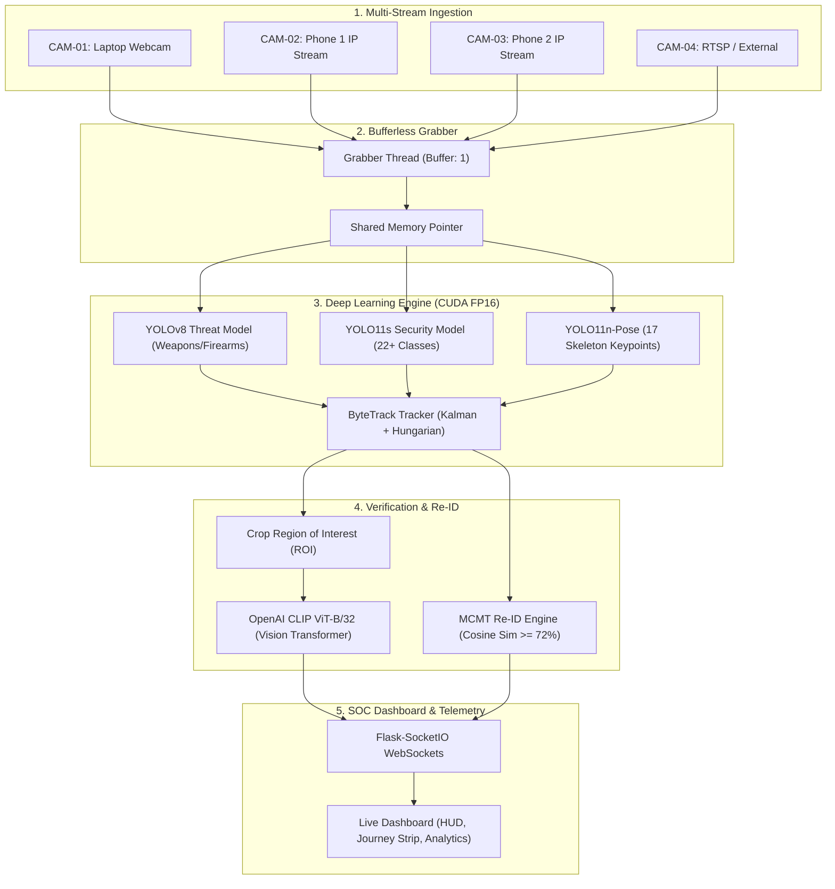

# 🛡️ Sentinel AI

> **An Intelligent Cognitive Surveillance, Multi-Threat Detection & Multi-Camera Multi-Target (MCMT) Re-ID System**

[](https://python.org)
[](https://pytorch.org)
[](https://github.com/ultralytics/ultralytics)
[](https://openai.com)
[-brightgreen?style=for-the-badge&logo=nvidia)](https://nvidia.com)
[](LICENSE)

**Sentinel AI** is an end-to-end, real-time computer vision surveillance operating system. Standard CCTV analytics suffer from frequent false positives (e.g., mistaking a smartphone for a firearm) and lose object identity the moment someone moves between cameras. 

Sentinel AI resolves this by coupling **triple-model convolutional object and pose detectors** (`YOLO11s` + `YOLO11n-Pose` + fine-tuned `YOLOv8 Threat Model`) with a **Zero-Shot Vision Transformer** (`OpenAI CLIP ViT-B/32`) and a **Cross-Camera Multi-Target Re-ID Engine**, running at a smooth **28–32 FPS on NVIDIA RTX 4050 GPU**.

📖 **Read the full academic project report:** [**`PROJECT_REPORT.md`**](PROJECT_REPORT.md)

---

## ✨ Key Capabilities & Novel Features

* **⚡ Multi-Camera Multi-Target (MCMT) Re-ID:**
  Uses normalized 512-dimensional embeddings from OpenAI CLIP (ViT-B/32) to track individual targets as they transition across multiple surveillance feeds (e.g., Laptop Webcam $\rightarrow$ Phone 1 $\rightarrow$ Phone 2) with cosine similarity matching ($\ge 72\%$).
* **🎯 Triple Deep Learning Inference Suite:**
  * **`YOLO11n-Pose`:** 17 skeleton keypoints for fall and physical aggression detection running on an alternating 2-frame cadence.
  * **`YOLOv8 Threat Model`:** Fine-tuned detector dedicated to firearms, handguns, assault rifles, knives, grenades, and explosives.
  * **`YOLO11s General Security Model`:** Real-time tracking of 22+ active classes (vehicles, backpacks, tech devices, sharp tools).
* **🔍 Zero-Shot Cognitive Verification (OpenAI CLIP):**
  When a candidate threat is detected, the Region of Interest (ROI) is cropped and cross-examined against high-dimensional textual semantic prompts. If CLIP disagrees, the false positive is automatically dropped.
* **⏱️ 5-Frame Temporal Smoothing Buffer:**
  Requires a threat to persist across $\ge 3$ out of 5 frames before raising alerts, filtering out momentary single-frame visual glitches.
* **🚀 Decoupled Asynchronous Grabber Threading:**
  Eliminates the standard 2–3 second OpenCV/RTSP network stream buffering lag by separating network frame capture (`buffer_size=1`) from GPU inference.
* **🎛️ Dynamic 4-Camera SOC Dashboard:**
  Full Single-Page Application (SPA) with automatic free slot assignment (`CAM-01` to `CAM-04`), manual slot overrides, live gauge arc, HUD bounding boxes, telemetry, dark mode, audio alerts, and CSV incident export.

---

## 🧠 End-to-End System Pipeline



---

## 🏷️ Active Target Classes (22 Categories)

| Category | Classes | Severity |
| :--- | :--- | :--- |
| **Human & Skeleton** | `person` (Pose, Fall Detection, Re-ID) | Dynamic / Safe |
| **Firearms** | `gun`, `pistol`, `rifle` | **CRITICAL** |
| **Explosives** | `grenade`, `bomb` / `explosion` | **CRITICAL** |
| **Edged Weapons** | `knife`, `scissors` | **CRITICAL / WARNING** |
| **Blunt Weapons** | `baseball bat` | **WARNING** |
| **Environmental** | `fire`, `smoke` | **CRITICAL / WARNING** |
| **Vehicles** | `car`, `truck`, `motorcycle`, `bus`, `bicycle` | INFO |
| **Luggage & Concealment** | `backpack`, `handbag`, `suitcase` | INFO / WARNING |
| **Electronics & Animals** | `cell phone`, `laptop`, `dog`, `cat`, `bottle` | INFO |

---

## 🔬 Model & Convolution Architecture Summary

* **Convolutional Layers:** $\sim 550$ convolutional operations actively executed per frame cycle across the CSPDarknet backbones, PANet necks, and decoupled anchor-free detection heads of `YOLO11n-Pose`, `YOLO11s`, and `YOLOv8 Threat`.
* **Vision Transformer (ViT-B/32):** 12 Transformer layers, 12 attention heads, 768 hidden dimension, projected into an $L_2$-normalized 512-dimensional vector.
* **Backpropagation Analysis:**
  * **Training Phase:** Backpropagation utilized via PyTorch autograd ($\frac{\partial \mathcal{L}}{\partial W}$) with SGD/AdamW optimizing CIoU, Distribution Focal Loss (DFL), BCE, and Object Keypoint Similarity (OKS) losses.
  * **Inference Phase:** All model weights are frozen (`requires_grad = False`), running in `torch.inference_mode()` on CUDA FP16 Tensor Cores without gradient computation graph overhead.
* **Datasets Used:** MS COCO 2017 (118k images), Roboflow Threat Dataset (10.8k annotated weapon images), COCO-Pose / CrowdPose (200k+ keypoint instances), and OpenAI WIT (400M multimodal pairs).

---

## 📊 Speed vs. Accuracy Benchmarks

Tested on **NVIDIA GeForce RTX 4050 Laptop GPU (6GB VRAM, CUDA 12.1)**:

| Configuration | Latency | Live FPS | mAP@0.5 | False Alarms | VRAM |
| :--- | :--- | :--- | :--- | :--- | :--- |
| Heavy Baseline (`YOLO11x` + Pose) | 125 ms | 8.0 FPS | 93.8% | 14.2% | 5.8 GB |
| Lightweight Baseline (`YOLO11s` alone) | 24 ms | 41.6 FPS | 86.4% | 18.5% | 1.8 GB |
| **Sentinel AI (Triple YOLO + CLIP + Buffer)** | **31 ms** | **28–32 FPS** | **92.6%** | **< 2.8%** | **3.4 GB** |

---

## 🛠️ Tech Stack

* **Deep Learning Framework:** PyTorch 2.4+ (CUDA 12.1), Torchvision
* **Computer Vision & Tracking:** Ultralytics (YOLO11 / YOLOv8), OpenCV (MJPEG hardware acceleration), ByteTrack
* **Foundation Models:** HuggingFace Transformers (OpenAI CLIP ViT-B/32)
* **Backend:** Python 3.12, Flask, Flask-SocketIO (WebSockets), Eventlet/Threading
* **Frontend:** HTML5, Vanilla JavaScript (ES6+), Chart.js, FontAwesome

---

## 🚀 Quickstart & Installation

### Prerequisites
* Python 3.12+
* NVIDIA GPU with CUDA 12.1+ installed (Recommended for $\ge 30$ FPS).

### Setup Steps

1. **Clone the repository:**
   ```bash
   git clone https://github.com/Siddhantkr07/DL-Project.git
   cd DL-Project
   ```

2. **Install dependencies:**
   ```bash
   pip install -r requirements.txt
   ```

3. **Launch the Sentinel AI SOC Server:**
   ```bash
   python dashboard/app.py
   ```

4. **Access the Dashboard:**
   Open your browser at `http://127.0.0.1:5000`.

### 📱 Connecting Phone Cameras (Multi-Camera Setup):
1. Install an IP Camera app on your smartphone (e.g., **IP Webcam** on Android).
2. Start the server on your phone (make sure phone and PC are on the same Wi-Fi).
3. On the Sentinel AI dashboard, click **"+ Add Camera"**:
   * **Phone 1:** Enter URL e.g. `http://192.168.1.50:8080/video` $\rightarrow$ Connects to **CAM-02**.
   * **Phone 2:** Enter URL e.g. `http://192.168.1.51:8080/video` $\rightarrow$ Automatically connects to **CAM-03** without replacing Phone 1!
4. Walk between the cameras: the **MCMT Re-ID** panel will trace your cross-camera journey in real time!

---

## 📄 License & Attribution

Developed by **[Siddhant Kumar](https://github.com/Siddhantkr07)** for B.Tech Computer Science (Deep Learning Project).  
Licensed under the [MIT License](LICENSE).
